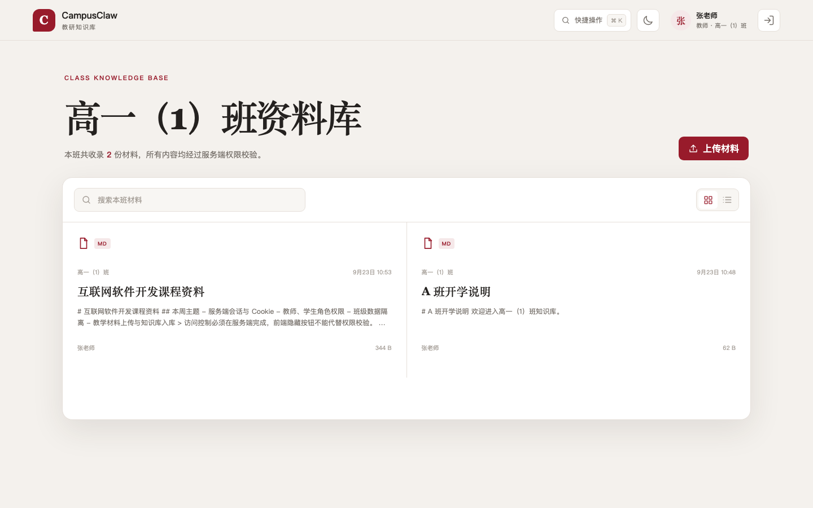
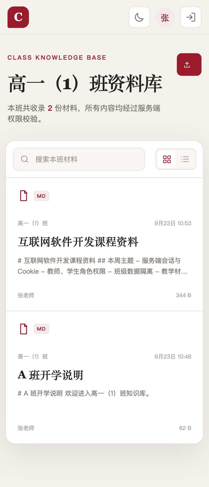

# CampusClaw 迭代 1 验收记录

验收日期：2026-09-23  
入口：`http://localhost:8080`

## 1. 结构与构建

### OpenSpec 严格校验

```text
$ npx --yes @fission-ai/openspec@latest validate add-auth-rbac-class-knowledge --strict
Change 'add-auth-rbac-class-knowledge' is valid
```

结论：**通过**。四件套完整，Requirement 与 Scenario 结构有效。

### 后端

```text
$ go test ./...
ok   campusclaw/backend/internal/config
ok   campusclaw/backend/internal/httpapi

$ go vet ./...
（退出码 0）
```

结论：**通过**。

### 前端

```text
$ npm audit
found 0 vulnerabilities

$ npm run build
✓ 279 modules transformed.
✓ built
```

结论：**通过**。

## 2. Compose 发布形态

```text
$ docker compose ps
api   Up (healthy)   8081/tcp
db    Up (healthy)   3306/tcp, 33060/tcp
web   Up (healthy)   0.0.0.0:8080->8080/tcp
```

宿主机访问 `localhost:8081` 得到连接失败（HTTP `000`）；通过 Nginx 请求 `/api/me` 得到预期的 `401`。因此 API 与数据库均未直接映射宿主端口，只有 web 对外。

结论：**通过**。

## 3. 主路径

运行：

```bash
TEACHER_PASSWORD='<本地 .env 中的教师口令>' \
STUDENT_PASSWORD='<本地 .env 中的学生口令>' \
bash scripts/verify.sh
```

关键输出：

```text
PASS  公开健康检查（HTTP 200）
PASS  未登录访问材料列表（HTTP 401）
PASS  教师登录（HTTP 200）
PASS  A 班学生登录（HTTP 200）
PASS  B 班学生登录（HTTP 200）
PASS  教师上传 Markdown（HTTP 201）
PASS  学生上传被拒绝（HTTP 403）
PASS  同班学生查看上传材料（HTTP 200）
PASS  跨班按 ID 访问被隐藏（HTTP 404）
PASS  同班学生鉴权下载（HTTP 200）
PASS  静态上传路径未返回原文件
```

结论：**通过**。教师可上传，材料表和知识库表各新增一行；同班学生可查看和下载。

## 4. 关键失败路径

### 未登录访问

- 请求：`GET /api/materials`
- 结果：HTTP `401`
- 响应不含材料标题、正文、文件名或存储路径

结论：**通过**。

### 学生上传

- 请求：学生会话 `POST /api/materials`
- 结果：HTTP `403`
- 上传前后材料表、知识库表和上传目录均不变

结论：**通过**。

### 跨班访问

- 请求：B 班学生按 ID 访问 A 班教师刚上传的材料
- 结果：HTTP `404`
- 响应与不存在记录同形，不含 A 班标题或正文

结论：**通过**。

### 上传输入校验

```text
双扩展名 .md.exe：400
空 .md：400
非法 UTF-8 .md：400
超过 1 MiB：413
材料行数：测试前后相同
```

结论：**通过**。

### 写库失败清理

验收时临时撤销应用数据库用户的 INSERT 权限并断开旧连接，随后上传合法文件：

```text
forced_db_failure_status=503
db_rows_before=4:4
db_rows_after=4:4
files_before=4
files_after=4
```

恢复权限后再次运行主路径成功。

结论：**通过**。数据库事务回滚，刚写入的文件被补偿删除，无孤立记录或文件。

## 5. 身份、角色与班级

- `/api/me` 返回 `user_id`、`role`、`class_id` 对应的用户信息。
- Cookie 具有 `HttpOnly` 与 `SameSite=Lax`。
- 前端 `localStorage` 仅包含主题和视图偏好，不含角色、班级或会话 ID。
- A 班账号附带伪造的 `class_id=2` 后，列表中的所有记录仍为 A 班。
- B 班学生列表仅出现 B 班材料。
- 学生页面不显示上传入口；绕过页面直接调用上传 API 仍为 403。
- 登出后使用旧 Cookie 请求 `/api/me` 返回 401。
- 用户不存在、口令错误、触发限流三种情况的响应均为：

```json
{"error":"用户名或密码错误"}
```

结论：**通过**。

## 6. 故障与持久化

停止数据库后：

```text
GET /health：200
GET /api/materials：503
```

执行一次 `docker compose down` 后再 `docker compose up -d`：

```text
materials_before_restart=3
materials_after_restart=3
```

结论：**通过**。存活探针不依赖数据库，业务故障语义正确，数据卷持久化生效。

## 7. 页面验收

- 教师、学生均可登录。
- 刷新后通过 `/api/me` 恢复身份。
- 本班列表、搜索、详情、鉴权下载正常。
- Markdown 的标题和加粗正常渲染。
- 上传含 `<script>` 的 Markdown 后，页面没有 script 元素且脚本未执行。
- 深浅色、列表/网格视图、快捷操作面板正常。
- 1440px 桌面与 390px 移动布局均可操作。

桌面运行截图：



移动端截图：



结论：**通过**。

## 8. 密钥与口令

- `.env` 只存在于本机并被 `.gitignore`、`.dockerignore` 排除。
- API 与 web 镜像中均不存在 `.env`。
- 仓库提交文件只包含 `.env.example` 占位值。
- `users.password_hash` 均为长度 60、前缀 `$2a$` 的 bcrypt 哈希。

结论：**通过**。

## 总结

OpenSpec 结构校验、主路径、失败路径、班级隔离、角色授权、上传事务、Compose 发布和页面验收均已通过，满足迭代 1 的完成定义。
